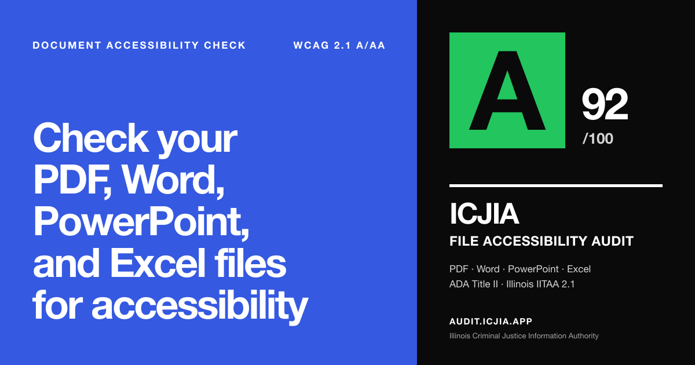

# a11y-audit — the command-line audit

The same engine as [audit.icjia.app](https://audit.icjia.app), run on your own
machine or in CI. It audits PDF, Word (.docx), PowerPoint (.pptx) and Excel
(.xlsx) files against WCAG 2.1 AA, prints a report in the format you ask for,
and ends with an exit status a build can act on.

Nothing is uploaded. Files are read from disk and analysed locally.

## Contents

- [Install from a checkout](#install-from-a-checkout)
- [Quick start](#quick-start)
- [What you can pass as a path](#what-you-can-pass-as-a-path)
- [Options](#options)
- [Gates](#gates)
- [Baseline](#baseline)
- [Exit status](#exit-status)
- [Config file](#config-file)
- [Output formats](#output-formats)
- [GitHub Actions: upload SARIF](#github-actions-upload-sarif)
- [The publist command](#the-publist-command)
- [Publishing to npm](#publishing-to-npm)

## Install from a checkout

The package is not on npm. It runs from a clone of this repository.

Requirements: Node 22 or newer, pnpm, and `qpdf` 10 or newer (only needed for
PDFs — `brew install qpdf`, `sudo apt-get install qpdf`).

```bash
git clone https://github.com/ICJIA/file-accessibility-audit.git
cd file-accessibility-audit
pnpm install
```

Then run it one of these ways. All three run the same file.

```bash
# from anywhere — paths are relative to the directory you are in
node /path/to/file-accessibility-audit/apps/cli/bin/a11y-audit.js docs/

# a shell alias makes that short
alias a11y-audit='node /path/to/file-accessibility-audit/apps/cli/bin/a11y-audit.js'

# through pnpm, from inside the repository
# (pnpm runs it in apps/cli, so give absolute paths)
pnpm --filter @icjia/a11y-audit a11y-audit "$PWD/docs"
```

The project runs TypeScript directly and has no build step.
`bin/a11y-audit.js` is a small launcher that turns that on and then loads the
real program, so the command behaves the same whichever directory it is
started from.

## Quick start

```bash
a11y-audit report.pdf                     # one file, readable report
a11y-audit docs/                          # every document in a folder
a11y-audit "docs/**/*.pdf" --fail-under 80
a11y-audit docs/ --format csv --output audit.csv
```

`a11y-audit audit <paths>` and `a11y-audit <paths>` are the same command.

## What you can pass as a path

| You pass | What is audited |
| --- | --- |
| A file | That file. Its type is read from its contents, so a PDF saved as `report.bin` works. A file that is neither a supported extension nor a PDF/Office file by content is a usage error. |
| A folder | Every `.pdf`, `.docx`, `.pptx` and `.xlsx` inside it, at any depth, in name order. Files with another extension are looked at too: a PDF header is enough, and a ZIP is audited only when the engine recognises it as an Office file. |
| A glob | The files it matches. Quote it so the shell does not expand it first. Supports `*` (within one folder), `**` (across folders), `?`, `[abc]`, `[!abc]` and `{a,b}`. |

Folder and glob searches skip `node_modules`, anything whose name starts with
a dot (`.git`, macOS `._name` sidecar files), and Office lock files (`~$name`).
A file reached more than once is audited once.

Legacy formats (`.doc`, `.ppt`, `.xls`, `.rtf`) are not audited. In a folder
they are skipped; named directly, they are a usage error.

## Options

### Output

| Flag | Meaning |
| --- | --- |
| `-f`, `--format <name>` | `text` (default), `json`, `ndjson`, `csv`, `junit`, `sarif` |
| `-o`, `--output <file>` | Write the report to a file instead of standard output. Folders are created. |
| `--json` | Same as `--format json` (the older flag). |
| `-q`, `--quiet` | Print nothing extra on the error stream (progress, "Report written", the reasons for a failure). |

### Gates

| Flag | Meaning |
| --- | --- |
| `--fail-under <n>` | Fail a file whose score is below `n` (0–100). `--threshold <n>` is the older name. |
| `--fail-on <level>` | Fail a file that has any category at this severity or worse: `critical`, `moderate` or `minor`. |
| `--fail-on-conformance` | Fail a file with a confirmed WCAG failure. `--no-fail-on-conformance` turns it back off when the config file turned it on. |
| `--baseline <file>` | Compare with scores saved earlier (see [Baseline](#baseline)). |
| `--update-baseline` | Save this run's scores as the baseline and stop. Default file: `.a11y-audit-baseline.json`. |

### Running

| Flag | Meaning |
| --- | --- |
| `-c`, `--concurrency <n>` | Files audited at once. Default 2. The engine runs a fixed number of analyses at a time (2 by default); a larger number is lowered to that and a note is printed. |
| `--exclude <glob>` | Leave out matching paths. Repeatable. A pattern with no `/` matches a file or folder name anywhere; `docs/old` also excludes everything under it. |
| `--allow-empty` | Finding nothing to audit is a pass. Without it, it is a usage error — a gate that silently checks nothing is worse than one that fails. |
| `--config <file>` | Read defaults from this file. |
| `--no-config` | Ignore any config file. |
| `-h`, `--help` / `-v`, `--version` | Help and version. |

Values can be written `--flag value` or `--flag=value`.

## Gates

With no gate, the command reports and exits 0 whatever the scores are. Each
gate you add can fail a file; one failed file fails the run.

- **`--fail-under 80`** — the overall score must be 80 or more.
- **`--fail-on moderate`** — no category may be Moderate or Critical.
  Categories that were not scored, or that carry only an unscored advisory,
  never trip this.
- **`--fail-on-conformance`** — the engine's WCAG verdict must have no
  confirmed failure. A finding marked "likely — please verify" (a judgement
  from how the page looks, such as bold text that looks like a heading) does
  not trip the gate on its own. An "incomplete" verdict has no failures, so it
  does not trip it either.

Why a file failed is printed with the report (`text`) or on the error stream
(every other format, and any report written to a file), and is in each
entry's `gateFailures`.

## Baseline

A baseline changes the question from "is every document good enough?" to "did
anyone make a document worse?". It is how you add a gate to a repository whose
existing documents do not pass yet.

```bash
# once, on the main branch
a11y-audit docs/ --update-baseline
git add .a11y-audit-baseline.json

# in CI
a11y-audit docs/ --baseline .a11y-audit-baseline.json --fail-under 80 --fail-on-conformance
```

With `--baseline`:

- A file **in the baseline** fails only if its score is **lower** than the
  recorded one. The other gates do not apply to it.
- A file **not in the baseline** is new, and must clear the other gates.
- A file is looked up by its path first, then by its contents (SHA-256), so a
  renamed or moved document is still recognised.

`--update-baseline` writes the file and exits 0 (or 3 if something could not
be audited); gates are not judged while recording. Files audited in the run
get their new score. A file that could not be audited keeps its old entry. A
file that was not part of the run keeps its entry while it still exists on
disk, so updating from a sub-folder does not forget the rest.

The file it writes:

```json
{
  "schemaVersion": 1,
  "tool": { "name": "a11y-audit", "version": "1.175.6" },
  "files": {
    "docs/annual-report.pdf": { "score": 82, "sha256": "9f2c…" }
  }
}
```

A hand-written plain map is also accepted — a path or `sha256:<hex>` to a score:

```json
{ "docs/annual-report.pdf": 82, "sha256:9f2c…": 71 }
```

Paths are relative to the directory the command runs in. Run it from the same
directory (normally the repository root) every time.

## Exit status

| Status | Meaning |
| --- | --- |
| `0` | Every file was audited and every gate passed. |
| `1` | A gate failed. |
| `2` | The command could not start: an unknown flag or bad value, a bad config or baseline file, a path that does not exist, nothing to audit, or `qpdf` missing when a PDF is in the run. Nothing was audited. |
| `3` | One or more files could not be audited (password-protected, damaged, unsupported), and no gate failed. |

When both happen, `1` wins: a failed gate is reported even if another file
could not be audited. The report's `summary.exitCode` holds the same number.

Earlier versions used `1` for both a failed threshold and an unreadable file,
and for a missing `qpdf`. Scripts that test for "non-zero" are unaffected;
scripts that test for exactly `1` should be checked.

## Config file

`.a11y-audit.json` (or `a11y-audit.config.json`) in the directory the command
runs in supplies defaults. `.a11y-audit.json` is used when both exist.

```json
{
  "paths": ["docs", "static/files"],
  "exclude": ["drafts", "docs/archive"],
  "failUnder": 80,
  "failOn": "critical",
  "failOnConformance": true,
  "baseline": ".a11y-audit-baseline.json",
  "format": "text",
  "concurrency": 2
}
```

| Key | Flag |
| --- | --- |
| `paths` | the paths on the command line |
| `exclude` | `--exclude` |
| `concurrency` | `--concurrency` |
| `format` | `--format` |
| `output` | `--output` |
| `failUnder` | `--fail-under` |
| `failOn` | `--fail-on` |
| `failOnConformance` | `--fail-on-conformance` |
| `baseline` | `--baseline` |
| `allowEmpty` | `--allow-empty` |
| `quiet` | `--quiet` |

Flags win over the file, one setting at a time: a flag replaces that setting
and leaves the rest of the file in force. Paths on the command line replace
`paths`. `exclude` is the exception — patterns from the file and from flags
are both applied.

An unknown key, a bad value, or invalid JSON is a usage error (exit 2), so a
misspelt gate cannot silently do nothing. A key starting with `//` is ignored
and can hold a comment.

## Output formats

Standard output carries only the report; progress and errors go to the error
stream, so `--format json | jq` is safe.

### json

Always one object of the same shape, for one file or a thousand:

```json
{
  "schemaVersion": 1,
  "tool": { "name": "a11y-audit", "version": "1.175.6" },
  "summary": {
    "files": 2,
    "analysed": 2,
    "errors": 0,
    "passed": 1,
    "failed": 1,
    "averageScore": 70,
    "lowestScore": 40,
    "grades": { "A": 1, "F": 1 },
    "gates": { "failUnder": 80, "failOn": null, "failOnConformance": false, "baseline": null },
    "exitCode": 1
  },
  "results": [
    {
      "path": "docs/annual-report.pdf",
      "filename": "annual-report.pdf",
      "sha256": "9f2c…",
      "bytes": 2879026,
      "status": "ok",
      "fileType": "pdf",
      "pageCount": 30,
      "score": 40,
      "grade": "F",
      "conformance": "fail",
      "confirmedFailures": 3,
      "passed": false,
      "gateFailures": [{ "gate": "fail-under", "message": "score 40 is below the minimum of 80" }],
      "baseline": null,
      "error": null,
      "analysis": { "…": "the engine's full result: categories, findings, conformance verdict" }
    }
  ]
}
```

Every entry has every key. For a file that could not be audited, `status` is
`"error"`, `error` is `{ "code", "message" }`, and the result fields are
`null`. `gateFailures[].gate` is one of `fail-under`, `fail-on`,
`fail-on-conformance`, `baseline`. `baseline` is `{ "score", "delta" }` when
the file was found in the baseline.

`analysis` is the engine's own result, unchanged — the same object the web
app's JSON export contains. It carries its own `schemaVersion` and
`engineVersion`.

**Changed from earlier versions:** `--json` used to print the engine result
itself for one file and a bare array for several. It now always prints the
object above. `jq '.overallScore'` becomes `jq '.results[0].score'` (or
`.results[0].analysis.overallScore`).

`schemaVersion` changes only when a field is removed or changes meaning. New
fields may be added without a change.

### ndjson

One JSON object per line: a `"type": "result"` line for each file (the same
entry as in `json`), then one `"type": "summary"` line with `schemaVersion`,
`tool` and `summary`.

### csv

One row per file. Columns:

`path`, `status`, `file_type`, `pages`, `score`, `grade`, `conformance`,
`confirmed_wcag_failures`, `passed` (`yes`/`no`), `gate_failures`,
`baseline_score`, `score_change`, then one column per scoring category
(`text_extractability`, `title_language`, `heading_structure`, `alt_text`,
`pdf_ua_compliance`, `bookmarks`, `table_markup`, `color_contrast`,
`link_quality`, `reading_order`, `form_accessibility`, `supplementary`,
`slide_titles`, `sheet_names`), then `sha256` and `error`.

The columns are the same in every run. A category a format does not have, or
that was not scored, is empty. A value that a spreadsheet would run as a
formula is prefixed with `'`.

### junit

For CI systems that show test results.

- One `<testsuite>` per file, with `score` and `grade` as properties.
- One `<testcase>` per scoring category, plus one named `gates`.
- A category testcase has a `<failure>` when its severity is at or above
  `--fail-on`. When `--fail-on` is not given, the report uses `minor` — any
  category that is not a pass. That default affects only this report, never
  the exit status.
- A category that was not scored is `<skipped/>`.
- The `gates` testcase fails when the file failed a gate.
- A file that could not be audited is a single testcase with an `<error>`.

### sarif

SARIF 2.1.0, for code-scanning tools.

- One result per failing finding. `ruleId` is the finding's stable code (for
  example `docx.title_language.title_missing`); `message.text` is the finding.
- `level` comes from the category's severity: Critical → `error`, Moderate →
  `warning`, Minor → `note`.
- The location is the document's path, relative to the directory the command
  ran in (`uriBaseId: %SRCROOT%`). These are binary files, so there is no line
  number; page numbers, counts and WCAG criteria are in `properties` when the
  engine supplies them.
- When a category that did not pass has no finding marked as a failure (or the
  result comes from an engine without finding codes), it gets one result with
  the category id as `ruleId` and the category's headline findings as the
  message.
- A file that could not be audited is a `toolExecutionNotifications` entry,
  not a result.

## GitHub Actions: upload SARIF

```yaml
name: Document accessibility
on:
  pull_request:
    paths: ["docs/**"]

jobs:
  a11y:
    runs-on: ubuntu-latest
    permissions:
      contents: read
      security-events: write # to upload SARIF
    steps:
      - uses: actions/checkout@v4

      - name: Get the audit tool
        uses: actions/checkout@v4
        with:
          repository: ICJIA/file-accessibility-audit
          path: .a11y-audit-tool

      - uses: pnpm/action-setup@v4
        with:
          version: 10
      - uses: actions/setup-node@v4
        with:
          node-version: 22

      - name: Install
        run: |
          sudo apt-get update && sudo apt-get install -y qpdf
          pnpm --dir .a11y-audit-tool install --frozen-lockfile

      - name: Audit documents
        run: >
          node .a11y-audit-tool/apps/cli/bin/a11y-audit.js docs/
          --baseline .a11y-audit-baseline.json
          --fail-under 80 --fail-on-conformance
          --format sarif --output a11y.sarif

      - name: Upload SARIF
        if: always() # upload even when the gate failed
        uses: github/codeql-action/upload-sarif@v3
        with:
          sarif_file: a11y.sarif
          category: document-accessibility
```

Run the audit from the repository root so the paths in the SARIF file match
the repository. The step fails the job on exit 1 (a gate), 2 (could not
start) or 3 (a file could not be audited); to let unreadable files through,
test for the status yourself:

```bash
node .a11y-audit-tool/apps/cli/bin/a11y-audit.js docs/ --fail-under 80 || [ $? -eq 3 ]
```

## The publist command

`a11y-audit publist` audits the ICJIA publication list and writes a CSV and an
HTML report. It is unchanged; run `a11y-audit publist --help` for its options.

## Publishing to npm

The package is marked `private` and is not published. Installing from a
checkout is the supported route. Publishing it would additionally need:

- `tsx` moved from `devDependencies` to `dependencies` (the launcher needs it
  at run time), or a compiled build so it is not needed at all;
- `@file-audit/analyzer` and `@file-audit/shared` published too, or bundled —
  they are private workspace packages today;
- the `#config` alias replaced: it points at `audit.config.ts` in the
  repository root, outside the package, and resolves only through the
  package's `tsconfig.json`;
- a `files` list, so `reports/`, `coverage/` and test files are not shipped;
- `"private": true` removed, and a decision on the name and scope.
